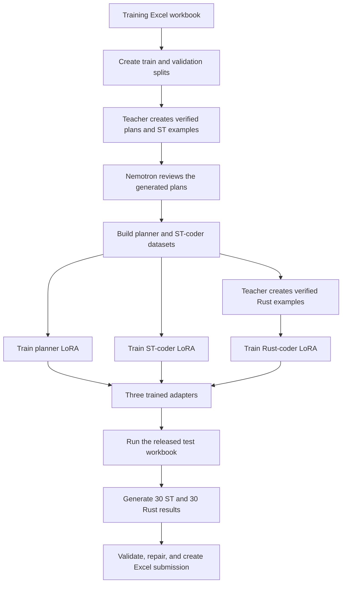
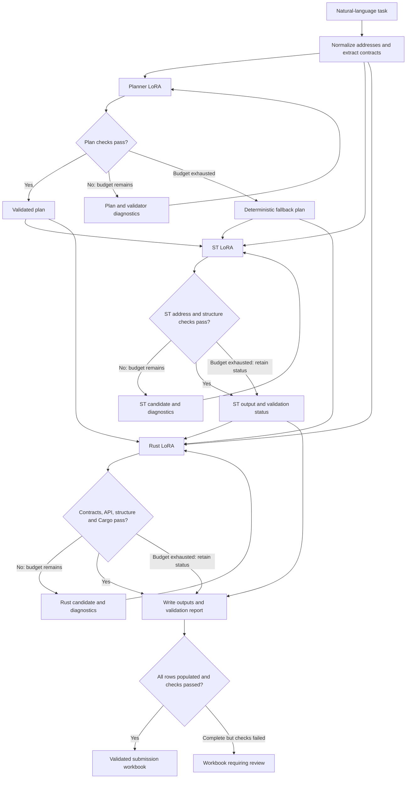

# NL2PLC three-adapter pipeline

This project converts a natural-language PLC task into two programs:

1. IEC 61131-3 Structured Text (`ST-CODE`)
2. Rust (`RUST-CODE`)

It uses three separate LoRA adapters built from the same Qwen2.5-Coder-7B
base model:

| Adapter | Input | Output |
|---|---|---|
| Planner LoRA | Natural-language task | A structured implementation plan |
| ST Coder LoRA | Task + validated plan | IEC 61131-3 Structured Text |
| Rust Coder LoRA | Task + plan + ST code | Rust implementation |

The adapters are loaded one after another, not simultaneously. This reduces
GPU memory use and keeps planning, ST generation, and Rust generation as
separate learnable tasks.

## End-to-end flow



During final inference, each test task follows this sequence:



All three stages retain the original requirement. Rust additionally receives
the selected plan and generated ST. The teacher and reviewer are used offline
for dataset preparation, not as final-inference generation stages. The adapters
share the same base-model architecture and are loaded sequentially.

The diagram summarizes the documented workflow. Planner fallback is not a
successful model repair and must be counted separately. Downstream generation
requires a usable ST candidate; an empty upstream result must be treated as a
failure rather than replaced with reference code.


## Two different workflows

The project has two clearly separate workflows:

- **Training workflow:** Steps 1-8 create datasets and train the three LoRA
  adapters. Run these steps only when training or retraining models.
- **Final inference workflow:** Step 9 onward uses already-trained adapters to
  generate the 30 competition results. If the adapters already exist, you can
  skip directly to Step 9.

## Expected project layout
Create the directories shown below before running the commands.
Run all commands from the project root:

```text
RUN-team meooo-01\
|-- data\
|-- models\
|-- runs\
|-- NL2PLC_Final_Test_Pipeline\
|-- build_nl2plc_sft_dataset.py
|-- generate_gold_algorithm_database.py
|-- audit_plans_nemotron.py
|-- build_two_adapter_sft.py
|-- train_lora_adapter.py
|-- prepare_rust_sft.py
|-- train_rust_lora.py
|-- predict_two_adapter.py
`-- predict_rust_adapter.py
```

Activate the environment:

```cmd
conda activate ssltest
cd RUN-team meooo-01
```

The examples below use Windows Command Prompt syntax. The caret (`^`) means
that the same command continues on the next line.

## Prerequisites

The full training pipeline requires:

- Python environment with the project requirements and Unsloth
- NVIDIA GPU for LoRA training and inference
- Ollama with the Qwen3-Coder teacher model
- Ollama with the Nemotron-Cascade-2 reviewer model
- Rust and Cargo for compiling generated Rust code
- `openpyxl` for reading and writing the final workbook

Check the external tools before starting:

```cmd
ollama show hf.co/unsloth/Qwen3-Coder-30B-A3B-Instruct-GGUF:Q4_K_M
ollama show nemotron-cascade-2:30b
cargo --version
python -c "import openpyxl; print(openpyxl.__version__)"
```

Do not use `--allow-missing-cargo` when preparing the final Rust dataset or
running final competition inference.

# Training workflow

## Step 1: Split the original training workbook

This step converts the organizer's training workbook into JSONL files. It
keeps training and validation examples separate.

```cmd
python build_nl2plc_sft_dataset.py ^
  --excel "Training-Dataset-AI4Industrial-Automation-FIRE-2026.xlsx" ^
  --output-dir "data\nl2plc_st_sft" ^
  --train-count 213 ^
  --validation-count 31 ^
  --test-count 29
```

Main outputs:

```text
data\nl2plc_st_sft\train.jsonl
data\nl2plc_st_sft\validation.jsonl
data\nl2plc_st_sft\test.jsonl
```

The 29-row `test.jsonl` above is an internal holdout split. It is not the
released 30-row competition test workbook.

## Step 2: Build verified algorithm databases

The teacher model reads each task and creates a canonical plan plus ST target.
The generator accepts an example only after its deterministic checks pass.

Optional one-example smoke test:

```cmd
python generate_gold_algorithm_database.py ^
  --input-jsonl "examples\gold_example.jsonl" ^
  --output-dir "runs\one_gold_example" ^
  --limit 1

python inspect_gold_database.py ^
  --database "runs\one_gold_example\gold_algorithms.sqlite3" ^
  --id row_0104
```

Build the full training database:

```cmd
python generate_gold_algorithm_database.py ^
  --input-jsonl "data\nl2plc_st_sft\train.jsonl" ^
  --output-dir "data\gold_algorithm_database"
```

Build a completely separate validation database:

```cmd
python generate_gold_algorithm_database.py ^
  --input-jsonl "data\nl2plc_st_sft\validation.jsonl" ^
  --output-dir "data\validation_algorithm_database"
```

Important enriched outputs:

```text
data\gold_algorithm_database\exports\enriched_master.jsonl
data\validation_algorithm_database\exports\enriched_master.jsonl
```

Never merge validation examples into the training database.

## Step 3: Review the teacher plans with Nemotron

Nemotron-Cascade-2 acts as an offline reviewer. It is used to filter weak or
semantically incorrect teacher examples before LoRA training.

Review training examples:

```cmd
python audit_plans_nemotron.py ^
  --input-enriched "data\gold_algorithm_database\exports\enriched_master.jsonl" ^
  --output-jsonl "data\reviews\train_cascade2_reviews.jsonl" ^
  --model "nemotron-cascade-2:30b" ^
  --num-ctx 16384 ^
  --temperature 0.1 ^
  --timeout 600
```

Review validation examples separately:

```cmd
python audit_plans_nemotron.py ^
  --input-enriched "data\validation_algorithm_database\exports\enriched_master.jsonl" ^
  --output-jsonl "data\reviews\validation_cascade2_reviews.jsonl" ^
  --model "nemotron-cascade-2:30b" ^
  --num-ctx 16384 ^
  --temperature 0.1 ^
  --timeout 600
```

## Step 4: Build the planner and ST-coder datasets

This stage converts accepted teacher records into two independent datasets:

- Planner dataset: normal planning examples plus plan-repair examples
- ST-coder dataset: validated task + plan -> Structured Text examples

Create an editable review manifest first:

```cmd
copy /Y "review_manifest.example.json" "review_manifest.json"
```

Then build the datasets:

```cmd
python build_two_adapter_sft.py ^
  --train-enriched "data\gold_algorithm_database\exports\enriched_master.jsonl" ^
  --validation-enriched "data\validation_algorithm_database\exports\enriched_master.jsonl" ^
  --review-manifest "review_manifest.json" ^
  --nemotron-reviews ^
    "data\reviews\train_cascade2_reviews.jsonl" ^
    "data\reviews\validation_cascade2_reviews.jsonl" ^
  --require-nemotron-pass ^
  --repairs-per-source 1 ^
  --output-dir "data\two_adapter_sft"
```

Main outputs:

| File | Meaning |
|---|---|
| `train_planner.jsonl` | Planner and plan-repair training examples |
| `validation_planner.jsonl` | Planner validation examples |
| `train_coder.jsonl` | ST-coder training examples |
| `validation_coder.jsonl` | ST-coder validation examples |
| `canonical_train_master.jsonl` | Verified training records used by later stages |
| `canonical_validation_master.jsonl` | Verified validation records used by later stages |
| `rejected_train.jsonl` | Training examples rejected by the gates |
| `rejected_validation.jsonl` | Validation examples rejected by the gates |
| `dataset_report.json` | Counts and rejection summary |

## Step 5: Train the planner LoRA

The planner learns to translate a task into a structured, address-aware
implementation plan. It does not generate ST code.

```cmd
python train_lora_adapter.py ^
  --adapter-role planner ^
  --model-name "unsloth/Qwen2.5-Coder-7B-Instruct-bnb-4bit" ^
  --train-jsonl "data\two_adapter_sft\train_planner.jsonl" ^
  --validation-jsonl "data\two_adapter_sft\validation_planner.jsonl" ^
  --output-dir "models\qwen25coder7b_planner_lora" ^
  --max-seq-length 3072 ^
  --epochs 3 ^
  --batch-size 1 ^
  --eval-batch-size 1 ^
  --gradient-accumulation-steps 8 ^
  --learning-rate 1e-4 ^
  --lora-rank 16 ^
  --lora-alpha 32 ^
  --eval-steps 20 ^
  --save-steps 20 ^
  --early-stopping-patience 2
```

Required output:

```text
models\qwen25coder7b_planner_lora\final_adapter
```

## Step 6: Train the ST-coder LoRA

The ST coder receives the original task and a validated plan. It generates a
complete IEC 61131-3 Structured Text program.

```cmd
python train_lora_adapter.py ^
  --adapter-role coder ^
  --model-name "unsloth/Qwen2.5-Coder-7B-Instruct-bnb-4bit" ^
  --train-jsonl "data\two_adapter_sft\train_coder.jsonl" ^
  --validation-jsonl "data\two_adapter_sft\validation_coder.jsonl" ^
  --output-dir "models\qwen25coder7b_coder_lora" ^
  --max-seq-length 4096 ^
  --epochs 3 ^
  --batch-size 1 ^
  --eval-batch-size 1 ^
  --gradient-accumulation-steps 8 ^
  --learning-rate 5e-5 ^
  --lora-rank 32 ^
  --lora-alpha 64 ^
  --eval-steps 20 ^
  --save-steps 20 ^
  --early-stopping-patience 2
```

Required output:

```text
models\qwen25coder7b_coder_lora\final_adapter
```

## Step 7: Validate the planner and ST coder together

This command first generates plans for all validation rows. It then unloads
the planner, loads the ST coder, and generates the ST programs.

```cmd
python predict_two_adapter.py ^
  --mode two_adapter ^
  --planner-adapter "models\qwen25coder7b_planner_lora\final_adapter" ^
  --coder-adapter "models\qwen25coder7b_coder_lora\final_adapter" ^
  --input-jsonl "data\nl2plc_st_sft\validation.jsonl" ^
  --output-jsonl "runs\two_adapter_validation.jsonl" ^
  --submission-output "runs\two_adapter_validation_compact.jsonl" ^
  --plan-repair-attempts 1 ^
  --code-retry-attempts 1 ^
  --max-seq-length 4096
```

Important outputs:

```text
runs\two_adapter_validation.plans.jsonl
runs\two_adapter_validation.jsonl
runs\two_adapter_validation.metrics.json
runs\two_adapter_validation_compact.jsonl
```

### Optional oracle-plan diagnostic

Oracle mode supplies the verified validation plan to the ST coder. It helps
locate the bottleneck:

- Strong oracle result but weak two-adapter result: improve the planner.
- Weak oracle and weak two-adapter results: improve the ST coder or dataset.

Oracle mode is only a diagnostic. Never use it on the released test set.

```cmd
python predict_two_adapter.py ^
  --mode oracle_plan ^
  --coder-adapter "models\qwen25coder7b_coder_lora\final_adapter" ^
  --input-jsonl "data\two_adapter_sft\canonical_validation_master.jsonl" ^
  --output-jsonl "runs\oracle_coder_validation.jsonl" ^
  --code-retry-attempts 1 ^
  --max-seq-length 4096
```

## Step 8: Prepare and train the Rust adapter

### 8.1 Prepare verified Rust SFT records

The Rust teacher uses the canonical task, verified plan, and gold ST code. A
generated Rust example is accepted only after deterministic contract checks,
`cargo check`, and—when required—the Nemotron semantic review.

The original workbook's `RUST-CODE` column is not used as the training target.

```cmd
python prepare_rust_sft.py ^
  --train-master "data\two_adapter_sft\canonical_train_master.jsonl" ^
  --validation-master "data\two_adapter_sft\canonical_validation_master.jsonl" ^
  --output-dir "data\rust_adapter_sft" ^
  --teacher-model "hf.co/unsloth/Qwen3-Coder-30B-A3B-Instruct-GGUF:Q4_K_M" ^
  --reviewer-model "nemotron-cascade-2:30b" ^
  --require-reviewer-pass ^
  --teacher-num-ctx 16384 ^
  --reviewer-num-ctx 16384 ^
  --max-repair-attempts 2 ^
  --repairs-per-source 1 ^
  --timeout 600 ^
  --cargo-timeout 120 ^
  --resume
```

Use `--resume` to reuse previously accepted records. After fixing a prompt,
runtime contract, or model issue, add `--retry-rejected` to regenerate only
the rejected records:

```text
--resume --retry-rejected
```

Do not use `--max-examples` with an existing full output directory. For a
small smoke test, use a new output directory.

Main outputs:

| File | Meaning |
|---|---|
| `train_rust_coder.jsonl` | Normal Rust-generation training examples |
| `train_rust_repair.jsonl` | Rust repair training examples |
| `validation_rust_coder.jsonl` | Rust validation examples |
| `verified_train_rust_master.jsonl` | Accepted training records |
| `verified_validation_rust_master.jsonl` | Accepted validation records |
| `rejected_train_rust.jsonl` | Rejected training records |
| `rejected_validation_rust.jsonl` | Rejected validation records |
| `train_generation_audit.jsonl` | Full training generation/repair history |
| `validation_generation_audit.jsonl` | Full validation generation/repair history |
| `dataset_report.json` | Acceptance and rejection statistics |

### 8.2 Train the Rust-coder LoRA

```cmd
python train_rust_lora.py ^
  --model-name "unsloth/Qwen2.5-Coder-7B-Instruct-bnb-4bit" ^
  --train-jsonl ^
    "data\rust_adapter_sft\train_rust_coder.jsonl" ^
    "data\rust_adapter_sft\train_rust_repair.jsonl" ^
  --validation-jsonl "data\rust_adapter_sft\validation_rust_coder.jsonl" ^
  --output-dir "models\qwen25coder7b_rust_lora" ^
  --max-seq-length 6144 ^
  --epochs 3 ^
  --batch-size 1 ^
  --eval-batch-size 1 ^
  --gradient-accumulation-steps 8 ^
  --learning-rate 5e-5 ^
  --lora-rank 32 ^
  --lora-alpha 64 ^
  --eval-steps 20 ^
  --save-steps 20 ^
  --early-stopping-patience 2
```

Required output:

```text
models\qwen25coder7b_rust_lora\final_adapter
```

### 8.3 Validate Rust generation

The Rust predictor reads the generated plan and ST code from the detailed
two-adapter validation file.

```cmd
python predict_rust_adapter.py ^
  --rust-adapter "models\qwen25coder7b_rust_lora\final_adapter" ^
  --input-jsonl "runs\two_adapter_validation.jsonl" ^
  --output-jsonl "runs\rust_adapter_validation.jsonl" ^
  --submission-output "runs\rust_adapter_validation_compact.jsonl" ^
  --reference-jsonl "data\rust_adapter_sft\verified_validation_rust_master.jsonl" ^
  --max-seq-length 8192 ^
  --max-new-tokens 3500 ^
  --repair-attempts 1 ^
  --cargo-timeout 120
```

`--reference-jsonl` is allowed only for validation metrics. Omit it for the
released test set.

# Final inference workflow

## Step 9: Verify that all three adapters exist

Each adapter directory must contain `adapter_config.json`:

```cmd
dir "models\qwen25coder7b_planner_lora\final_adapter\adapter_config.json"
dir "models\qwen25coder7b_coder_lora\final_adapter\adapter_config.json"
dir "models\qwen25coder7b_rust_lora\final_adapter\adapter_config.json"
```

To list every available adapter if a path is uncertain:

```cmd
where /r models adapter_config.json
```

The current final pipeline uses:

```text
Planner: models\qwen25coder7b_planner_lora\final_adapter
ST coder: models\qwen25coder7b_coder_lora\final_adapter
Rust coder: models\qwen25coder7b_rust_lora\final_adapter
```

Do not use a `qwen25coder7b_planner_lora_v2` path unless that optional adapter
was actually trained and selected using validation results.


## Step 10: Generate all 30 final results

The released workbook contains exactly 30 tasks. The pipeline preserves their
worksheet order and assigns internal IDs `test_0001` through `test_0030`.

```cmd
python NL2PLC_Final_Test_Pipeline\final_test_pipeline.py ^
  --test-xlsx "NL2PLC_Final_Test_Pipeline\data\Test-Dataset-AI4Industrial-Automation.xlsx" ^
  --planner-adapter "models\qwen25coder7b_planner_lora\final_adapter" ^
  --coder-adapter "models\qwen25coder7b_coder_lora\final_adapter" ^
  --rust-adapter "models\qwen25coder7b_rust_lora\final_adapter" ^
  --output-dir "runs\final_test_strict30" ^
  --expected-results 30 ^
  --plan-repair-attempts 3 ^
  --code-retry-attempts 4 ^
  --rust-repair-attempts 4 ^
  --repair-temperature 0.20 ^
  --strict-exit
```

The strict pipeline guarantees that a result workbook is written only when
all 30 `ST-CODE` cells and all 30 `RUST-CODE` cells are populated. Validation
status is tracked separately from population status.

## Step 11: Understand the final output files

All final files are written under:

```text
runs\final_test_strict30
```

| File | Purpose |
|---|---|
| `final_test_input.jsonl` | The 30 ordered model inputs |
| `final_test_manifest.json` | Original worksheet rows and normalization audit |
| `st_detailed.jsonl` | Plans, ST candidates, repairs, and validation results |
| `st_detailed.plans.jsonl` | Complete plan-generation histories |
| `st_detailed.metrics.json` | Planner and ST metrics |
| `rust_detailed.jsonl` | Rust candidates, repairs, and compiler checks |
| `rust_detailed.metrics.json` | Rust validation metrics |
| `final_test_predictions.jsonl` | Merged ST and Rust predictions in row order |
| `final_test_report.json` | Final completeness and readiness decision |

There are two possible Excel outputs.

### Automatically validated submission

```text
runs\final_test_strict30\FINAL_SUBMISSION.xlsx
```

This is created when all 30 ST programs and all 30 Rust programs pass the
configured automated checks. The report contains:

```json
"ready_to_submit": true
```

### Complete workbook requiring review

```text
runs\final_test_strict30\STRICT_30_RESULTS_NEEDS_REVIEW.xlsx
```

This file still contains all 30 ST and 30 Rust results, but at least one local
validator reported a problem. Inspect the failing IDs in
`final_test_report.json` and verify those rows manually.

If the reported failures are validator false positives and all 30 rows have
been manually verified, keep the original review file and create a submission
copy:

```cmd
copy /Y ^
  "runs\final_test_strict30\STRICT_30_RESULTS_NEEDS_REVIEW.xlsx" ^
  "FINAL_SUBMISSION.xlsx"
```

The submission workbook must contain exactly these three columns in the
original order:

```text
TASK | ST-CODE | RUST-CODE
```

Do not add an ID, validation, status, or index column to the workbook.

## Step 12: Resume an interrupted final run

Use the same adapter paths and output directory, and add `--resume`:

```cmd
python NL2PLC_Final_Test_Pipeline\final_test_pipeline.py ^
  --test-xlsx "NL2PLC_Final_Test_Pipeline\data\Test-Dataset-AI4Industrial-Automation.xlsx" ^
  --planner-adapter "models\qwen25coder7b_planner_lora\final_adapter" ^
  --coder-adapter "models\qwen25coder7b_coder_lora\final_adapter" ^
  --rust-adapter "models\qwen25coder7b_rust_lora\final_adapter" ^
  --output-dir "runs\final_test_strict30" ^
  --expected-results 30 ^
  --plan-repair-attempts 3 ^
  --code-retry-attempts 4 ^
  --rust-repair-attempts 4 ^
  --repair-temperature 0.20 ^
  --resume ^
  --strict-exit
```

`--resume` reuses a stage only when it already contains all 30 expected IDs in
the correct order and every row is valid. Partial or invalid stages are
regenerated instead of being treated as complete.

## Step 13: Rebuild Excel after manual JSONL correction

If you manually correct candidates inside `st_detailed.jsonl` or
`rust_detailed.jsonl`, rebuild the workbook without running the models again:

```cmd
python NL2PLC_Final_Test_Pipeline\final_test_pipeline.py ^
  --test-xlsx "NL2PLC_Final_Test_Pipeline\data\Test-Dataset-AI4Industrial-Automation.xlsx" ^
  --output-dir "runs\final_test_strict30" ^
  --assemble-only ^
  --strict-exit
```

## How the repair loops work

The repair loops are bounded. They do not retry forever.

| Stage | What is validated | What happens after failure |
|---|---|---|
| Plan | JSON/schema, addresses, protected values, required constructs | Planner receives the invalid plan and exact validator errors |
| ST code | Address contract and required ST structure | ST coder regenerates the complete program |
| Rust code | Address contract, I/O API, runtime structure, and Cargo compilation | Rust coder receives the invalid code and exact errors |

The validators catch many structural problems, but they cannot mathematically
prove that every program behaves correctly. Semantic tests and careful manual
review remain important, especially for the workbook named
`STRICT_30_RESULTS_NEEDS_REVIEW.xlsx`.

## Data-leakage rules

To keep validation and hidden-test measurements valid:

1. Never merge validation examples into training.
2. Never provide gold ST, gold Rust, or an oracle plan during released-test
   inference.
3. Use `--reference-jsonl` only for validation metrics.
4. Select planner v1 or an optional planner v2 using validation results, not
   released-test results.
5. Keep the original 30 test-row order in the final workbook.

## Evaluation and supplementary analysis

**Reporting status:** Official scores below are available from the working note.
The tables define the additional evaluation needed to address the reviews.

### Official competition results

| Target | Our score | Best reported score | Gap |
|---|---:|---:|---:|
| Structured Text | 79.31 | 81.78 | 2.47 |
| Rust | 44.20 | 61.55 | 17.35 |

The official score is 0.25 × cosine similarity + 0.25 × structural match +
0.50 × program dependence graph similarity. Reference agreement does not prove
functional correctness. Keep official results separate from internal experiments.

### Ablation experiments

| Configuration | ST score | Rust score | ST validator pass rate | Rust validator pass rate | Mean seconds/task |
|---|---:|---:|---:|---:|---:|
| Direct task-to-code generation | TBD | TBD | Yet to update | Yet to update | Yet to update |
| Cascade without repair | TBD | TBD | Yet to update | Yet to update | Yet to update |
| Full cascade with validator-guided repair | TBD | TBD | Yet to update | Yet to update | Yet to update |

Used the same examples, base model, scoring implementation, and comparable
training/decoding settings. 

The 29-example internal split was used for development according to the paper;
it must not be described as an untouched test set. Report counts alongside
percentages because the evaluation sets are small. Apply all conditions to the
same cases and report missing/failed outputs rather than silently dropping them.

### Validation and repair effectiveness

| Stage | Cases | Initial failures | Successful model repairs | Failures after repair | Fallback uses |
|---|---:|---:|---:|---:|---:|
| Planner | Yet to update | Yet to update | Yet to update | Yet to update | Yet to update |
| ST | Yet to update | Yet to update | Yet to update | Yet to update | N/A |
| Rust | Yet to update | Yet to update | Yet to update | Yet to update | N/A |

- Initial failure rate = initially failing cases / evaluated cases.
- Repair success rate = initially failing cases that pass after regeneration /
  initially failing cases. Report N/A when there are no initial failures.
- Residual failure rate = cases still failing after the repair budget /
  evaluated cases. Count planner failures before fallback separately.
- Fallback rate = cases using deterministic planner fallback / planner cases.
- Report mean repair attempts over all cases and over initially failing cases.

Separate address, literal, schema, structural, API, and compilation failures
where the corresponding validator exists. Report the number of cases checked
by each validator and allow overlapping error categories. A validator pass is
not evidence of full behavioral correctness.

### Repair and decoding configuration

The final-inference command documented above specifies:

| Setting | Value |
|---|---:|
| Planner repair attempts | 3 |
| ST retry attempts | 4 |
| Rust repair attempts | 4 |
| Repair temperature | 0.20 |

Record initial-generation temperature, sampling enabled/disabled, top-p, top-k,
maximum new tokens per stage, context limits, stop tokens, random seed, and
Cargo timeout from the actual run. 

### Hardware and training configuration

The GPU used for this work is an NVIDIA GeForce RTX 5090 Founders Edition.
The workstation configuration below is based on the author's supplied hardware
information. Hardware capacity is distinct from measured consumption during a run.

| Hardware | Configuration |
|---|---|
| GPU | NVIDIA GeForce RTX 5090 Founders Edition |
| GPU memory capacity | 32 GB nominal; previously reported by `nvidia-smi` as 32607 MiB |
| CPU | AMD Ryzen 9 9950X |
| System RAM capacity | 64 GB |
| Execution arrangement | Three adapters loaded sequentially |

NVIDIA driver 581.80 and a CUDA compatibility version of 13.0 reported by `nvidia-smi`. 
The following training settings are documented in the manuscript and commands:

| Setting | Planner | ST coder | Rust coder |
|---|---|---|---|
| Base model | Qwen2.5-Coder-7B-Instruct | Qwen2.5-Coder-7B-Instruct | Qwen2.5-Coder-7B-Instruct |
| Base loading | 4-bit quantization | 4-bit quantization | 4-bit quantization |
| LoRA rank | 16 | 32 | 32 |
| LoRA alpha | 32 | 64 | 64 |
| Learning rate | 1e-4 | 5e-5 | 5e-5 |
| Maximum training sequence length | 3072 | 4096 | 6144 |
| Maximum epochs | 3 | 3 | 3 |
| Per-device training batch size | 1 | 1 | 1 |
| Gradient accumulation steps | 8 | 8 | 8 |
| Effective batch size on one GPU | 8 | 8 | 8 |
| Evaluation batch size | 1 | 1 | 1 |
| Evaluation/save interval, steps | 20 | 20 | 20 |
| Early-stopping patience, evaluation intervals | 2 | 2 | 2 |

### Dataset and documented inference settings

| Item | Documented value |
|---|---|
| Initial training split | 213 instances |
| Initial validation split | 31 instances |
| Internal development holdout | 29 instances |
| Released competition test set | 30 tasks |
| Required final outputs | 30 ST programs and 30 Rust programs |
| ST validation context limit | 4096 tokens in the example command |
| Rust validation context limit | 8192 tokens in the example command |
| Rust validation maximum new tokens | 3500 |
| Rust validation repair attempts | 1 |
| Rust validation Cargo timeout | 120 seconds |
| Offline teacher/reviewer context setting | 16384 |
| Offline plan reviewer temperature | 0.1 |

Split counts precede subsequent supervision filtering and repair-example
augmentation; they are not final adapter training-record counts. Validation
command settings above must not be assumed to be final-test defaults. Final
retry settings are recorded in the preceding repair-configuration table.

### Computational cost and parameter efficiency

| Measurement | Planner | ST | Rust |
|---|---:|---:|---:|
| Trainable adapter parameters | TBD | TBD | TBD |
| Trainable parameters / base parameters, % | TBD | TBD | TBD |
| Mean initial-generation seconds/task | TBD | TBD | TBD |
| Mean validation seconds/task | TBD | TBD | TBD |
| Mean additional repair seconds/task | TBD | TBD | TBD |
| Peak GPU memory, GB | TBD | TBD | TBD |
| Mean GPU utilization, % | TBD | TBD | TBD |

### Rust intermediate-output diagnostic

Rust training uses verified plans and gold/verified ST intermediates, whereas
inference uses generated intermediates. Upstream errors may therefore propagate
into Rust even when local checks pass. The custom runtime also differs from the
benchmark's RoboPLC/Modbus-oriented reference structure. Teacher-generated Rust
targets may favor that custom structure. These are hypotheses about the score
gap until supported by controlled measurements.

| Inputs to the same Rust checkpoint | Rust score | Validator pass rate |
|---|---:|---:|
| Verified plan + gold ST | TBD | Yet to update |
| Generated plan + gold ST | TBD | Yet to update |
| Verified plan + generated ST | TBD | Yet to update |
| Generated plan + generated ST | TBD | Yet to update |

### Systematic error analysis

| Error category | Cases | Evidence |
|---|---:|---|
| Missing, changed, or additional addresses | Yet to update | Contract diagnostics |
| Rust syntax/type errors | Yet to update | Cargo diagnostics |
| Incorrect I/O API or runtime structure | Yet to update | Interface/structure checks |
| Incorrect timing/reset/state/control behavior | Yet to update | Behavioral tests or manual inspection |
| Upstream errors reflected in Rust | Yet to update | Paired plan/ST/Rust inspection |
| Structural differences from reference Rust | Yet to update | Reference comparison |

Report overlapping categories explicitly. Compilation cannot establish timing,
scan-cycle, reset, or safety-priority correctness. Distinguish suspected causes
from errors confirmed by a test or manual inspection.

## Quick troubleshooting

### Adapter directory not found

The adapter argument must point to the directory that directly contains
`adapter_config.json`:

```cmd
where /r models adapter_config.json
```

Use the matching parent `final_adapter` directory in the inference command.

### Cargo not found

```cmd
python -c "import shutil; print(shutil.which('cargo'))"
```

If this prints `None`, open a terminal where Rust is installed and reactivate
the Conda environment before running the pipeline.

### Rust prediction says that ST code is missing

This means an upstream two-adapter row did not contain a usable
`predicted_st`. Fix or regenerate that ST row before measuring the complete
end-to-end pipeline. Do not replace it with validation gold ST.

### `--strict-exit` returns a nonzero exit code

The pipeline can still create `STRICT_30_RESULTS_NEEDS_REVIEW.xlsx` before
returning a nonzero status. Read `final_test_report.json`; the nonzero status
means at least one automated validation gate did not pass.

## Final checklist

Before submission, verify:

- [ ] Exactly 30 task rows are present.
- [ ] Every `ST-CODE` cell is populated.
- [ ] Every `RUST-CODE` cell is populated.
- [ ] Row order matches the released workbook.
- [ ] The workbook has only `TASK`, `ST-CODE`, and `RUST-CODE` columns.
- [ ] No validation answer, gold code, or oracle plan was used for test rows.
- [ ] Any IDs listed in `final_test_report.json` were reviewed.
